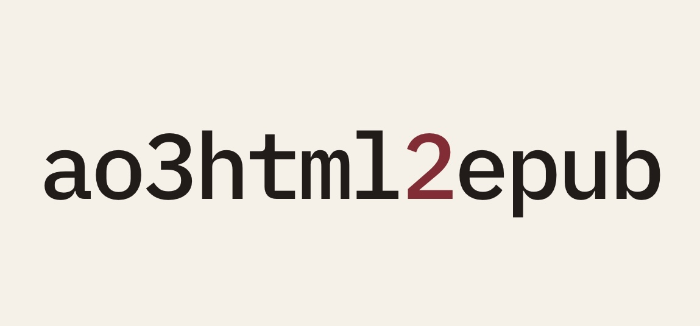

<p align="center">
  
</p>


**ao3html2epub** converts an AO3 fic that you downloaded as HTML into an EPUB.

Since the great outage of October 2026, AO3 only offers downloads as HTML. This script turns those files into
e-books, much like AO3's own EPUB downloads used to be.

- the title page has the tags, summary, author's notes and a link to the work on AO3
- the book ends with a link back to the work, so you can find your way back to leave kudos and comments

> **Please do go back and leave kudos and comments on the original fic!!!**
> 
> **Writers love hearing from readers!!!**

## You need

- Python 3.9 or newer ([how?](https://wiki.python.org/python/getting-started/BeginnersGuide/Download.html))
- An AO3 story saved with Download > HTML
- [`html2epub.py`](html2epub.py) from this repository

## Use

Open the Terminal app ([how?](https://sindresorhus.com/guides/open-terminal-in-folder-mac#:~:text=In%20Finder,Supercharge%2E)) or Command Prompt ([how?](https://www.aakashg.com/how-to-open-files-in-cmd/#:~:text=Method,pathtofolder)) in the folder where you saved `html2epub.py` (probably in your downloads folder).

One fanfic:

```
python3 html2epub.py "My Story.html"
```

A whole folder with fanfics:

```
python3 html2epub.py "my-folder"
```

On Windows, type `python` instead of `python3`.

The EPUBs appear in a new `epub` folder next to your HTML. Files in the folder that aren't AO3 stories are skipped.

To put them somewhere else, add `-o "folder"`:

```
python3 html2epub.py "My Story.html" -o "Books"
```

## Good to know

- Images in stories are left out.
- Recent Kindles can read EPUBs sent with [Send to Kindle](https://www.amazon.com/sendtokindle).

## License

MIT. See [LICENSE](LICENSE).

